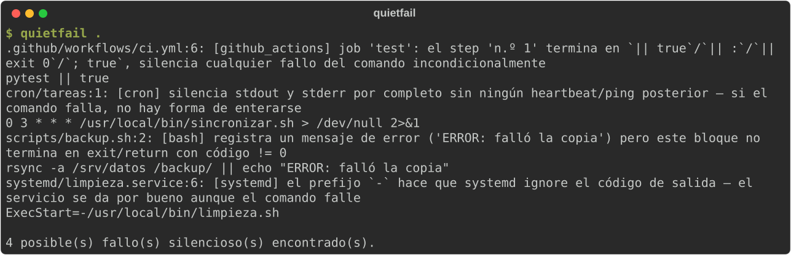

# quietfail

Encuentra scripts, unidades systemd, crontabs y workflows de GitHub Actions
que **registran un error pero terminan en éxito de todas formas**.

Este es el patrón: un job corre cada noche, algo dentro de él detecta que
falta configuración o que una operación no se pudo completar, lo escribe en
el log con un `echo "ERROR: ..."` bien visible... y el script sigue adelante
hasta su final natural sin llamar nunca a `exit 1`. `systemd`/`cron`/CI solo
miran el código de salida, así que el job se marca como un éxito rotundo —
puede llevar así semanas o meses sin que nadie se entere, porque no hay nada
roto que salte a la vista: solo un mensaje de error enterrado entre miles de
líneas de log que nadie lee a menos que ya sospeche algo.

`quietfail` es un análisis estático: no ejecuta nada, no necesita historial
de ejecuciones ni un servicio de "ping" al que avisar — lee el código fuente
y comprueba si ese error, una vez detectado, tiene realmente un camino hacia
un exit code que no sea 0.

## Así se ve



<sub>Ejecución real sobre un script de backup, una unidad systemd, un crontab y un workflow de CI que esconden sus fallos (todos los datos son ficticios).</sub>

## Instalación

```bash
pip install quietfail
```

## Uso

```bash
quietfail .                     # analiza el directorio actual
quietfail scripts/backup.sh     # o un fichero suelto
quietfail --keyword AVISO .     # añade una palabra clave de error propia
```

Sale con código 1 si encuentra algo (útil como paso de CI), 0 si está limpio.

## Qué detecta

| Formato | Patrón |
|---|---|
| Scripts bash/sh | Una rama `if`/`elif`/`else` o de `case`, un bucle, el cuerpo de una función o un grupo `{ …; }`/subshell (como en `cmd \|\| { echo ERROR; }`) registra un mensaje de error (`echo`/`printf`/`logger`, ERROR/CRITICAL/FATAL/FAIL por defecto, sin contar variables ni opciones como `--critical`) y ese mismo bloque no contiene después ningún `exit`/`return` con código != 0 |
| Unidades systemd (`.service`) | `ExecStart=-…` (el prefijo `-` ignora el código de salida) y `\|\| true` / `\|\| :` / `\|\| exit 0` al final, también dentro de `sh -c '…'` — el comando real puede fallar, systemd siempre lo ve como éxito. Las unidades de la distribución (`/usr/lib/systemd/system`) usan `ExecStart=-` a propósito (gettys…): analiza las tuyas, `/etc/systemd/system` |
| Crontabs | Una entrada silencia stdout y stderr por completo (`>/dev/null 2>&1`) sin ningún heartbeat/ping posterior — si falla, nadie se entera nunca |
| Workflows de GitHub Actions | Un step con `continue-on-error: true` cuyo `steps.<id>.outcome` nunca se comprueba después, o un `run:` con una línea que termina en `\|\| true`, `\|\| :`, `\|\| exit 0` o `; true` |

## Qué NO detecta (a propósito)

Es un check mecánico y de precisión alta, no un analizador de flujo de
control completo — el mismo criterio que llevó a acotar
[`staleif`](https://github.com/jl-segurayuste/staleif) a un subconjunto
100% comprobable en vez de intentar "juicio semántico" general:

- Solo mira el bloque *inmediato* que contiene el mensaje de error (la
  rama del if, el cuerpo del bucle/función). No sigue la propagación a
  bloques exteriores ni evalúa el contenido de variables.
- No sabe qué imprime `echo "$mensaje_dinamico"` — solo texto literal.
- Un `exit`/`return` con argumento dinámico (`exit $?`, `exit "$status"`)
  se asume "puede propagar el fallo" (beneficio de la duda) para no
  generar falsos positivos.

Menos casos detectados, pero los que reporta son reales.

## Por qué esto y no un servicio de monitorización tipo "dead man's switch"

Herramientas como Healthchecks.io/Cronitor/etc. avisan cuando un job
**no llega a ejecutarse o no manda su ping** — muy útil, pero es
monitorización en producción: necesita que el job ya esté desplegado,
corriendo, y fallando de verdad durante un tiempo antes de que salte
la alarma. `quietfail` es lo contrario: un check estático sobre el
propio código, que se puede correr en CI antes de desplegar nada,
sin necesitar ninguna ejecución real.

## Arquitectura

Cuatro scanners independientes bajo `quietfail/scanners/` (`bash.py`,
`systemd.py`, `cron.py`, `github_actions.py`), cada uno con su propia
lógica de detección y sus propios tests. `cli.py` solo decide, por
extensión/ubicación del fichero, a qué scanner mandarlo.

Los scripts se leen con [tree-sitter-bash](https://github.com/tree-sitter/tree-sitter-bash),
que entiende el bash real (`[[ … ]]`, `$(( … ))`, heredocs, `case`) y se recupera de
los errores de sintaxis. Si un fichero no se pudo leer entero, `quietfail` lo dice
por stderr (`no se pudo analizar …: análisis parcial`) y analiza lo que sí pudo: un
fichero saltado en silencio sería justo el tipo de fallo que busca.

## Desarrollo

```bash
python -m venv .venv && source .venv/bin/activate
pip install -e ".[dev]"
ruff check .
pytest
```
